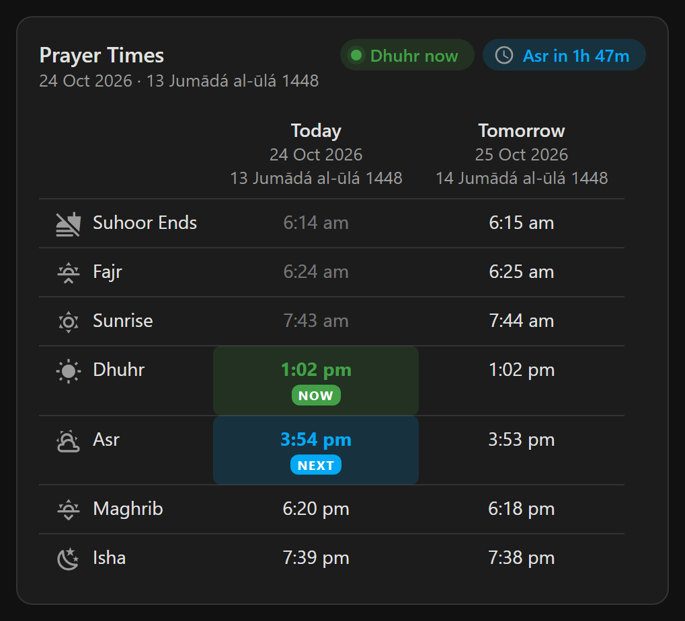
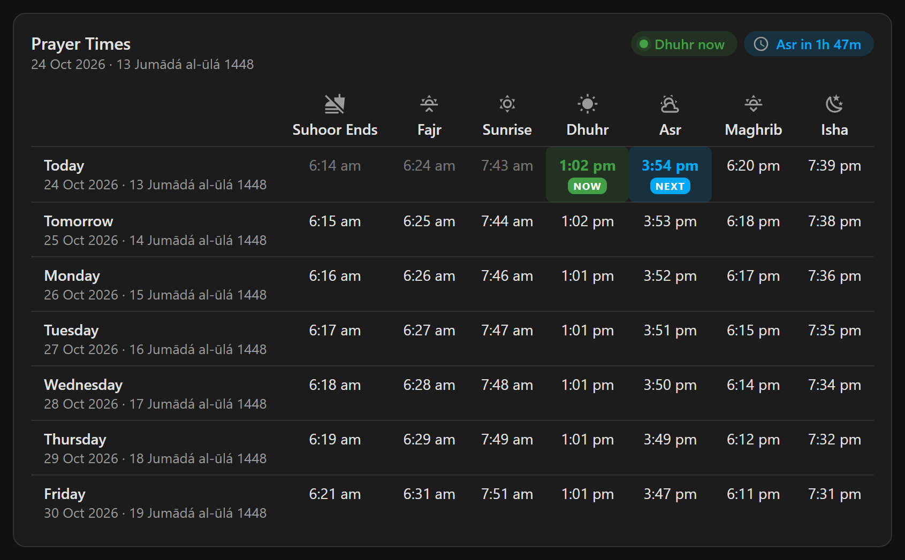
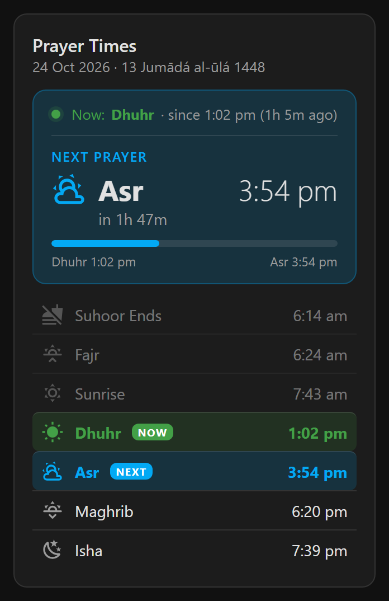
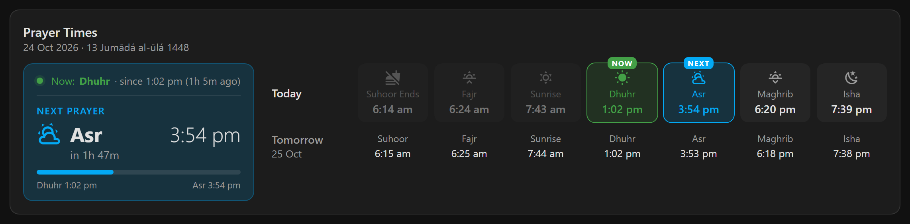
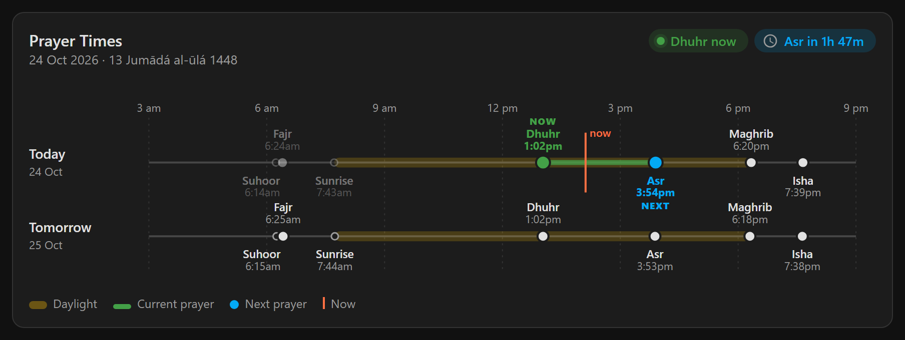
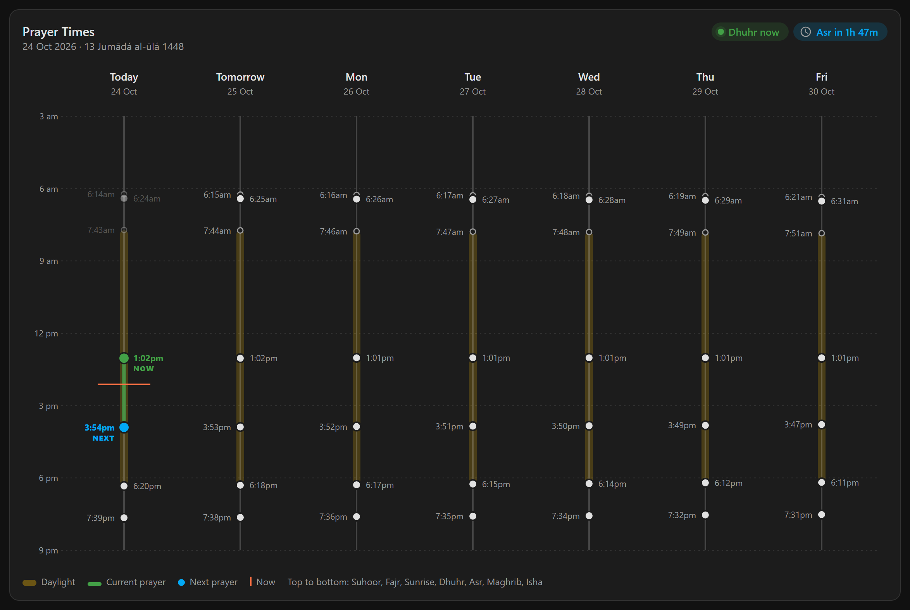
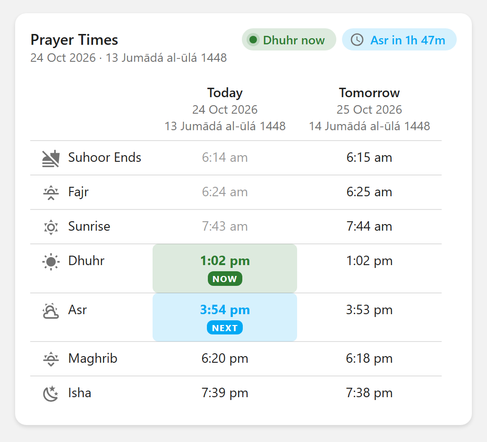

# Prayer Times Display for Home Assistant

[](https://hacs.xyz/docs/faq/custom_repositories)
[](https://github.com/rifazrifky/home-assistant-prayer-times-display/actions/workflows/validate.yml)
[](https://github.com/rifazrifky/home-assistant-prayer-times-display/releases)

Daily Islamic prayer times for any location in Home Assistant: sensors you can automate with, and a dashboard card that shows up to a week of times with the current and next prayer highlighted.

<p align="center">
  
</p>

> **Data source:** prayer times, Hijri dates and time zones come from the free public [Aladhan prayer times API](https://aladhan.com/prayer-times-api). This is an independent project and isn't affiliated with or endorsed by Aladhan.com or Islamic Network. See [Data sources and attribution](#data-sources-and-attribution).

## Contents

- [Features](#features)
- [Requirements](#requirements)
- [Installation](#installation)
- [Configuration](#configuration)
- [Calculation methods](#calculation-methods)
- [How it works](#how-it-works)
- [Entities](#entities)
- [Dashboard card](#dashboard-card)
- [Automation and template examples](#automation-and-template-examples)
- [Privacy](#privacy)
- [Troubleshooting and FAQ](#troubleshooting-and-faq)
- [Updating and removing](#updating-and-removing)
- [Development](#development)
- [Data sources and attribution](#data-sources-and-attribution)
- [License](#license)

## Features

- **Set up from the UI.** Search for a city, confirm it on a map, and the time zone and a suggested calculation method are filled in for you. No YAML, no API key.
- **Any number of locations.** Add your home, your parents' city or anywhere else; each becomes its own device.
- **Automation-ready sensors.** Imsak (end of suhoor), Fajr, Sunrise, Dhuhr, Asr, Maghrib and Isha for today and tomorrow, as timestamp sensors you can trigger on directly, with or without an offset.
- **Gregorian and Hijri dates** for today and tomorrow.
- **A rolling 7-day schedule**, refreshed automatically each night.
- **A dashboard card that loads by itself** (no resource to add), showing 1 to 7 days in three designs, each vertical or horizontal:
  - **Table**: times in a grid with an icon per prayer
  - **Next prayer focus**: a large countdown to the next prayer
  - **Timeline**: each day drawn as a line through the day
- **Current and next prayer highlighted**, updating live, with passed prayers dimmed.
- **23 calculation methods** and Standard or Hanafi Asr, changeable at any time.
- **Follows your Home Assistant settings**: 12/24-hour time, language for dates, time zone and theme colours.

## Requirements

- Home Assistant **2025.2** or newer. The integration's icon shows from 2026.3.
- Internet access to `api.aladhan.com`, and to `geocoding-api.open-meteo.com` while adding a location.

## Installation

### HACS (recommended)

[](https://my.home-assistant.io/redirect/hacs_repository/?owner=rifazrifky&repository=home-assistant-prayer-times-display&category=integration)

Or add it to HACS by hand:

1. In HACS, open the menu (⋮) → **Custom repositories**.
2. Add `https://github.com/rifazrifky/home-assistant-prayer-times-display` with type **Integration**.
3. Search for **Prayer Times Display** and download it.
4. Restart Home Assistant.

### Manual

1. Download the latest [release](https://github.com/rifazrifky/home-assistant-prayer-times-display/releases).
2. Copy `custom_components/prayer_times_display` into the `custom_components` folder of your Home Assistant configuration directory (create the folder if it doesn't exist).
3. Restart Home Assistant.

## Configuration

[](https://my.home-assistant.io/redirect/config_flow_start/?domain=prayer_times_display)

Or go to **Settings → Devices & services → Add integration → Prayer Times Display**. Setup takes up to three steps.

### 1. Search

Type a city or town, for example `London` or `Toronto`. Leave it blank to use your Home Assistant home location.

### 2. Pick

If several places match, choose the right one from the list, for example *London, England, United Kingdom* rather than *London, Ontario, Canada*. You can also type a different name in the box to search again. With a single match, this step is skipped.

### 3. Confirm

Everything is filled in from the place you picked. Check it and submit:

| Field | Description |
| --- | --- |
| Location (map) | Drag the pin to fine-tune the exact spot |
| Latitude / Longitude | The same position as numbers. If you edit these, they take priority over the pin |
| Name | Used for the device and entity names, so keep it short, e.g. `Home` → `sensor.home_fajr` |
| Time zone | The location's time zone. It decides when "today" starts for this location |
| Calculation method | Suggested from the country; see [Calculation methods](#calculation-methods) |
| Asr juristic method | **Standard** (Shafi, Maliki, Hanbali) or **Hanafi**, which gives a later Asr |

Home Assistant setup forms can't update fields while you type, so if you move the pin or change the coordinates, submitting refreshes the **time zone** for the new spot and shows the form again for a final check. A time zone you picked yourself is kept. The name and method aren't changed, so update them if the new spot needs it.

Each location can only be added once. Adding the same coordinates again shows "This location is already configured".

### Changing settings later

Open **Settings → Devices & services → Prayer Times Display** and click **Configure** on a location to change its **calculation method** or **Asr juristic method**. The new times are fetched straight away.

To move a location to different coordinates, delete it and add it again. You can rename the device and its entities at any time from Home Assistant's device page.

### Multiple locations

Add the integration again for each city. Every location gets its own device and sensors, and each card can show a different location (see the `device_id` card option).

## Calculation methods

Authorities use different sun angles for Fajr and Isha, so times can differ by several minutes between methods. When you pick a place, setup suggests the method used in that country; anywhere not listed falls back to **Muslim World League**. Always check the result against your local mosque or official announcements.

| Method | Suggested for |
| --- | --- |
| Shia Ithna-Ashari, Leva Institute, Qum | |
| University of Islamic Sciences, Karachi | Afghanistan, Bangladesh, India, Pakistan |
| Islamic Society of North America (ISNA) | Canada, United States |
| Muslim World League | Default for all other countries |
| Umm Al-Qura University, Makkah | Saudi Arabia |
| Egyptian General Authority of Survey | Egypt |
| Institute of Geophysics, University of Tehran | Iran |
| Gulf Region | Bahrain, Oman |
| Kuwait | Kuwait |
| Qatar | Qatar |
| Majlis Ugama Islam Singapura | Singapore |
| Union Organization Islamic de France | France |
| Diyanet İşleri Başkanlığı, Turkey | Turkey |
| Spiritual Administration of Muslims of Russia | Russia |
| Moonsighting Committee Worldwide | United Kingdom |
| Dubai | United Arab Emirates |
| Jabatan Kemajuan Islam Malaysia (JAKIM) | Malaysia |
| Tunisia | Tunisia |
| Algeria | Algeria |
| Kementerian Agama Republik Indonesia | Indonesia |
| Morocco | Morocco |
| Comunidade Islamica de Lisboa | Portugal |
| Ministry of Awqaf, Jordan | Jordan |

The angles behind each method are documented at [aladhan.com/calculation-methods](https://aladhan.com/calculation-methods).

## How it works

```
Aladhan API ──► integration (per location) ──► sensors ──► automations, templates
                     │                            │
                     └── keeps 7 days in memory   └── "Weekly schedule" sensor ──► dashboard card
```

- **Fetching.** On setup the integration fetches 7 days of times for the location. From then on it checks every 5 minutes whether the date has changed in the location's time zone, and only then fetches the one new day. In practice that's one request per location per day.
- **If Aladhan can't be reached** when a new day starts, the sensors show as unavailable and the fetch is retried every 5 minutes until it works. If it fails during setup, Home Assistant retries setting the location up on its own.
- **Times are stored as moments in time**, not text, so they're shown in each user's own 12/24-hour format and time zone, and work directly as automation triggers.
- **The card is served by the integration** and loaded on every dashboard automatically. It reads the location's *Weekly schedule* sensor and works out the current and next prayer in your browser, re-checking every 30 seconds.

## Entities

Each location becomes a device. For a location named `Home`:

| Entity | State | Notes |
| --- | --- | --- |
| `sensor.home_date` | Today's date, e.g. `2026-10-24` | |
| `sensor.home_hijri_date` | e.g. `13 Jumādá al-ūlá 1448` | Attributes: `day`, `month`, `month_name`, `month_name_ar`, `year` |
| `sensor.home_imsak` | Timestamp | End of suhoor (start of the fast) |
| `sensor.home_fajr` | Timestamp | |
| `sensor.home_sunrise` | Timestamp | End of Fajr time |
| `sensor.home_dhuhr` | Timestamp | |
| `sensor.home_asr` | Timestamp | Depends on the Asr juristic method |
| `sensor.home_maghrib` | Timestamp | |
| `sensor.home_isha` | Timestamp | At high latitudes this can fall after midnight |
| `sensor.home_tomorrow_date`, `sensor.home_tomorrow_hijri_date`, `sensor.home_tomorrow_imsak` … `sensor.home_tomorrow_isha` | Same as above, for tomorrow | |
| `sensor.home_weekly_schedule` | `7` (days available) | Attribute `days`: a list of 7 entries, each with `date`, `hijri_date` and the seven times. Used by the card; this attribute isn't saved to history |

Every sensor carries the attribution "Data provided by Aladhan.com".

## Dashboard card

The card is registered automatically once the integration is set up. Edit a dashboard, click **Add card** and pick **Prayer Times Display**, then use the visual editor, or add it in YAML:

```yaml
type: custom:prayer-times-display-card
title: Prayer Times
days: 2
design: table
rendering_style: vertical
alignment: left
```

### Options

| Option | Default | Description |
| --- | --- | --- |
| `device_id` | first location | Which location to show if you have several. Easiest to pick in the visual editor (**Location**) |
| `title` | `Prayer Times` | Shown at the top of the card |
| `days` | `1` | How many days to show: `1` (today only) to `7`. `2` adds tomorrow; later days are labelled with the weekday |
| `design` | `table` | `table`, `focus` or `timeline`; see below |
| `rendering_style` | `vertical` | `vertical` or `horizontal`; see below |
| `alignment` | `left` | `left`, `center` or `right`, for the table and focus designs when the card is wider than its content |

### Current and next prayer

Every design highlights the **current prayer** in green with a **Now** tag and the **next prayer** in blue with a **Next** tag. Prayers that have already passed today are dimmed.

- The current prayer is the last of Fajr, Dhuhr, Asr, Maghrib and Isha to have started.
- Fajr's time ends at sunrise, so between sunrise and Dhuhr only the next prayer is marked.
- After Isha, the next prayer is tomorrow's Fajr. It's highlighted in the Tomorrow column if tomorrow is shown.
- Suhoor ends and Sunrise are shown for reference but are never marked as current or next.

### Design: table

Times in a grid, with an icon per prayer and "Dhuhr now" and "Asr in 1h 47m" badges in the header.

| Vertical: prayers as rows, days as columns | Horizontal: days as rows, prayers as columns |
| --- | --- |
|  |  |

```yaml
type: custom:prayer-times-display-card
design: table
days: 7
rendering_style: horizontal
```

### Design: next prayer focus

A large panel with the next prayer, a countdown and a progress bar from the previous prayer, plus what's current. Today's times are listed alongside, and any further days are shown more compactly.

| Vertical: panel above today's list | Horizontal: panel beside a row of times per day |
| --- | --- |
|  |  |

```yaml
type: custom:prayer-times-display-card
design: focus
days: 1
rendering_style: vertical
```

Ideal for a wall tablet or a phone dashboard where the next prayer matters most.

### Design: timeline

Each day drawn as a line through the day, with every prayer placed at its actual time, daylight between sunrise and Maghrib shaded, the current prayer's time drawn in green and the current time marked with a red line. The hour range adjusts to fit the times shown.

**Horizontal**: days as rows, time running left to right. The track stretches to fit the card's width.



**Vertical**: days as columns, time running top to bottom. With 3 or more days, each point is labelled with its time only; the order top to bottom is Suhoor, Fajr, Sunrise, Dhuhr, Asr, Maghrib, Isha.



```yaml
type: custom:prayer-times-display-card
design: timeline
days: 2
rendering_style: horizontal
```

### Layout tips

- **3 or more days** read best in the horizontal table or the horizontal timeline, shown full width.
- In a **sections** dashboard the card starts full width; resize it from the card's **Layout** tab. The vertical 7-day timeline is about 1,100 px wide and shrinks to fit narrower spaces.
- The **focus** and **vertical table** designs suit narrow columns and phones.

### Themes

The card uses your Home Assistant theme's colours, so it looks at home in light and dark themes:

| Theme variable | Used for |
| --- | --- |
| `--success-color` | Current prayer |
| `--primary-color` | Next prayer, countdown and progress bar |
| `--error-color` | The "now" line on the timeline |
| `--primary-text-color`, `--secondary-text-color`, `--divider-color`, `--card-background-color` | Text, labels and lines |



All times on the card follow the time format, language and time zone in your Home Assistant user profile.

## Automation and template examples

The examples use a location named `Home`; replace `home` with your location's name.

### Notify at every prayer

```yaml
alias: Prayer time notification
triggers:
  - trigger: time
    at: sensor.home_fajr
    id: Fajr
  - trigger: time
    at: sensor.home_dhuhr
    id: Dhuhr
  - trigger: time
    at: sensor.home_asr
    id: Asr
  - trigger: time
    at: sensor.home_maghrib
    id: Maghrib
  - trigger: time
    at: sensor.home_isha
    id: Isha
actions:
  - action: notify.mobile_app_phone
    data:
      title: Prayer time
      message: "It's time for {{ trigger.id }}"
```

### Play the adhan on a speaker

```yaml
alias: Adhan
triggers:
  - trigger: time
    at: sensor.home_dhuhr
  - trigger: time
    at: sensor.home_asr
  - trigger: time
    at: sensor.home_maghrib
  - trigger: time
    at: sensor.home_isha
actions:
  - action: media_player.play_media
    target:
      entity_id: media_player.living_room
    data:
      media_content_id: media-source://media_source/local/adhan.mp3
      media_content_type: music
```

Put the audio file in your `media` folder first. Many people use a separate, gentler adhan for Fajr; add a second automation for it.

### Suhoor reminder in Ramadan

Use an offset to trigger before a time. This reminds you 30 minutes before suhoor ends, only during Ramadan (Hijri month 9):

```yaml
alias: Suhoor reminder
triggers:
  - trigger: time
    at:
      entity_id: sensor.home_imsak
      offset: "-00:30:00"
conditions:
  - condition: template
    value_template: "{{ state_attr('sensor.home_hijri_date', 'month') == 9 }}"
actions:
  - action: notify.mobile_app_phone
    data:
      message: "Suhoor ends in 30 minutes"
```

### Lights before Fajr

```yaml
alias: Wake up for Fajr
triggers:
  - trigger: time
    at:
      entity_id: sensor.home_fajr
      offset: "-00:15:00"
actions:
  - action: light.turn_on
    target:
      entity_id: light.bedroom
    data:
      brightness_pct: 30
```

### Template sensor: next prayer

Add to `configuration.yaml` (or create it under **Settings → Devices & services → Helpers → Template**) for a sensor with the next prayer's time and name:

```yaml
template:
  - sensor:
      - name: Next prayer
        device_class: timestamp
        state: >
          
          
            
            
              
            
          
          {{ ns.at or states('sensor.home_tomorrow_fajr') }}
        attributes:
          prayer: >
            
            
              
              
                
              
            
            {{ ns.name }}
```

### Using the weekly schedule in templates

```jinja

  {{ day.date }} ({{ day.hijri_date }}): Maghrib {{ (day.maghrib | as_datetime | as_local).strftime('%H:%M') }}

```

## Privacy

- **Aladhan** receives each location's coordinates, time zone, calculation method and Asr method, once per day per location (and when you add a location).
- **Open-Meteo** receives the place name you type in the search box, only while you're adding a location.
- Nothing else leaves your Home Assistant. There are no accounts, API keys, analytics or tracking, and the card makes no network requests of its own.

## Troubleshooting and FAQ

**The card is missing from the card picker, or shows "Custom element not found: prayer-times-display-card".**
The card is loaded once the integration has been set up, but your browser may still be using a cached copy of Home Assistant from before. Reload with Ctrl+F5. If that doesn't help, open the browser's developer tools (F12) → **Application → Service workers**, click **Unregister**, and reload again. On the mobile app, use **Settings → Companion app → Debugging → Reset frontend cache**.

**The card says "No prayer times found".**
Set up the integration first, then reload the page.

**The card says "The selected prayer times location was not found".**
The location the card was set to has been deleted. Edit the card and pick another **Location**.

**The sensors are unavailable.**
Home Assistant couldn't reach Aladhan when the day changed. The integration retries every 5 minutes, so check your internet connection; the sensors come back on their own. [Debug logging](#debug-logging) shows the error.

**The times differ from my local mosque.**
Try another calculation method or the other Asr method under **Configure**. Some mosques publish their own timetable with adjustments no method matches exactly; in that case, pick the closest method.

**The Hijri date is a day off from local announcements.**
The Hijri date comes from Aladhan's calendar calculation. Countries that start months by local moon sighting can differ by a day, especially at the start of a month. This integration doesn't offer a manual Hijri adjustment yet.

**I live far north or south and some times look extreme.**
At high latitudes in summer, the sun may not go far enough below the horizon for the usual Fajr and Isha angles, so times can be very early or late. Isha falling after midnight is handled correctly. Methods such as **Moonsighting Committee Worldwide** or **Muslim World League** often give more usable results there; check with your local community.

**Can I edit a location's coordinates?**
Not after setup: delete the location and add it again. The calculation method and Asr method can be changed at any time under **Configure**.

### Debug logging

Add this to `configuration.yaml`, restart, and check **Settings → System → Logs**:

```yaml
logger:
  logs:
    custom_components.prayer_times_display: debug
```

When [reporting an issue](https://github.com/rifazrifky/home-assistant-prayer-times-display/issues), include your Home Assistant version, the integration version, the card's YAML if it's about the card, and any related log lines.

## Updating and removing

### Updating

HACS shows an update when a new release is published. Update, then restart Home Assistant and reload your browser. With a manual install, replace the `custom_components/prayer_times_display` folder with the one from the new release. See the [releases page](https://github.com/rifazrifky/home-assistant-prayer-times-display/releases) for what changed.

### Removing

1. Go to **Settings → Devices & services → Prayer Times Display**, open the menu (⋮) on each location and choose **Delete**.
2. Remove any cards using `custom:prayer-times-display-card` from your dashboards.
3. If installed with HACS, remove it in HACS; otherwise delete `custom_components/prayer_times_display`.
4. Restart Home Assistant.

## Development

### Project structure

```
custom_components/prayer_times_display/
├── __init__.py          Sets up locations and serves the card to the frontend
├── api.py               Aladhan API client: prayer times and time zone lookup
├── config_flow.py       Setup steps (search, pick, confirm) and the Configure options
├── const.py             Calculation methods, country suggestions, prayer names
├── coordinator.py       Keeps the rolling 7 days and fetches new days
├── geocode.py           Open-Meteo place search
├── sensor.py            Today, tomorrow and weekly schedule sensors
├── manifest.json        Integration metadata and version
├── icons.json           Entity icons
├── translations/en.json UI text for setup, options and entity names
├── brand/               Integration icon shown by Home Assistant 2026.3+
└── frontend/
    └── prayer-times-display-card.js   The dashboard card and its visual editor
assets/icon.svg          Editable source of the icon
docs/images/             Screenshots used in this README
```

### Trying out changes

1. Copy `custom_components/prayer_times_display` into a test Home Assistant's `custom_components` folder.
2. Restart Home Assistant, then add the integration.
3. After changing the card, reload the browser with Ctrl+F5. Bumping `version` in `manifest.json` also makes browsers fetch the new card, since the version is part of the card's address.

Turn on [debug logging](#debug-logging) to see each API request.

### Validation

Every push and pull request runs the [Validate workflow](.github/workflows/validate.yml), which uses the HACS action and Home Assistant's hassfest to check the integration's structure, manifest and translations. Note that hassfest doesn't allow links inside `translations/en.json`; pass them in as description placeholders from the config flow instead.

### Contributing

Issues and pull requests are welcome.

1. Create a branch from `main`, for example `fix/…` or `feat/…`.
2. Make your change, and update this README if it affects what users see.
3. Open a pull request into `main`; the Validate workflow must pass.

### Releasing

1. Bump `version` in `custom_components/prayer_times_display/manifest.json` following [semantic versioning](https://semver.org): patch for fixes, minor for new features, major for changes that break existing setups.
2. Merge into `main`, then tag the merge commit, for example `v1.3.0`, and publish a GitHub release for the tag. HACS offers releases, not the latest commit, to users.

## Data sources and attribution

This integration doesn't calculate or host any prayer time data itself. It calls these public services:

| Service | Used for | When | Terms |
| --- | --- | --- | --- |
| [Aladhan prayer times API](https://aladhan.com/prayer-times-api) by [Islamic Network](https://islamic.network) | Prayer times, Hijri dates, time zone of a location | Once a day per location, plus when adding a location | [Credits and terms](https://aladhan.com/credits-and-terms). Free to use, no API key; provided without warranty, and times may not match every local authority |
| [Open-Meteo Geocoding API](https://open-meteo.com/en/docs/geocoding-api) | Searching for a place by name | Only while adding a location | Free for non-commercial use; data under [CC BY 4.0](https://open-meteo.com/en/license) |

Each sensor carries the attribution "Data provided by Aladhan.com". This project is independent and isn't affiliated with or endorsed by Aladhan.com, Islamic Network or Open-Meteo. Their names are used only to identify the data sources. Icons in the card are from [Material Design Icons](https://pictogrammers.com/library/mdi/), as bundled with Home Assistant.

Prayer times are calculations. Always confirm them against your local mosque or official announcements.

## License

[MIT](LICENSE)
